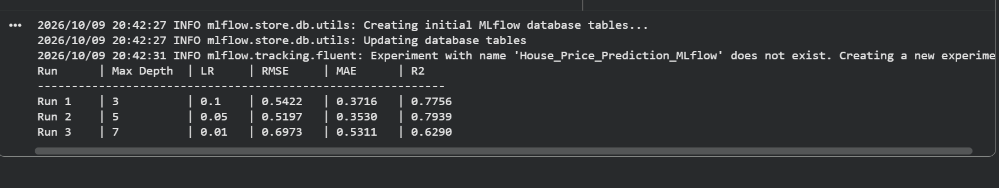

# ML Experiment Tracking with MLflow

## Task Description
This project focuses on tracking and comparing machine learning experiments using **MLflow**. Using the **California Housing Dataset**, we train a `GradientBoostingRegressor` model across three different hyperparameter configurations to predict house prices and identify the best-performing model based on evaluation metrics.

## Project Structure
```
mlflow-task/
├── train.py
├── requirements.txt
└── README.md
```

## How to Run
1. **Clone the repository:**
   ```bash
   git clone <YOUR_REPOSITORY_URL>
   cd mlflow-task
   ```

2. **Install dependencies:**
   ```bash
   pip install -r requirements.txt
   ```

3. **Run the training script:**
   ```bash
   python train.py
   ```

4. **Launch the MLflow UI to view results:**
   ```bash
   mlflow ui
   ```
   Open your browser and navigate to `http://127.0.0.1:5000`.

---

## MLflow Experiment Results

### UI Screenshot


### Comparison Table

| Run | Max Depth | Learning Rate | RMSE | MAE | R² |
| :--- | :---: | :---: | :---: | :---: | :---: |
| **Run 1** | 3 | 0.1 | 0.5422 | 0.3716 | 0.7756 |
| **Run 2** | 5 | 0.05 | 0.5197 | 0.3530 | 0.7939 |
| **Run 3** | 7 | 0.01 | 0.6973 | 0.5311 | 0.6290 |

---

## Selected Best Model & Explanation

- **Selected Best Model:** `Run 2`
- **Reasoning:** RMSE was chosen as the primary metric for model selection[cite: 3]. **Run 2** achieved the lowest Root Mean Squared Error (RMSE = 0.5197) and the highest R² score (0.7939) on the validation set[cite: 8], showing that a `max_depth` of 5 paired with a `learning_rate` of 0.05 yields the optimal trade-off between model complexity and generalizability.